# Rediseño y visibilidad en buscadores — fase 1: análisis y propuesta

Fecha: 2026-11-28 · Web analizada: `main` en `32ed687` (slurp v1.4.0), publicada en
`https://imjuank.dev/slurp-web/`.

Esta fase no cambia nada de `main`. Todo lo de aquí vive en la rama `rediseno`.

**Regla que no se toca:** el contenido es el de hoy. Ninguna cifra nueva, ninguna eliminada sin
preguntar, y los cinco idiomas dicen lo mismo. Se mantienen el logo, el naranja de marca y el
fondo oscuro.

Índice: [1. Diagnóstico](#1-diagnóstico-de-diseño) · [2. Direcciones](#2-direcciones-de-diseño) ·
[3. Buscadores y asistentes](#3-visibilidad-en-buscadores-y-asistentes) ·
[4. Línea base](#4-línea-base-lighthouse) · [5. Decisiones que necesito](#5-decisiones-que-necesito)

---

## 1. Diagnóstico de diseño

Medido sobre la web actual (EN), a 375 px y a 1280 px. Capturas en `docs/rediseno/actual/`.

Algunas cifras de la propia página, para situar el diagnóstico:

| | Móvil (375 px) | Escritorio (1280 px) |
|---|---|---|
| Altura total | 16.881 px (unas 21 pantallas de 812 px) | 12.741 px (unas 16 de 800 px) |
| «How it works» | 3.970 px | 2.706 px |
| «Benchmark» | 3.241 px | 2.494 px |

- 2.498 palabras en el cuerpo (EN), 11 secciones, 5 tablas, 6 bloques de código.
- **34 tamaños de letra distintos** en el CSS, 15 de ellos entre 0,68 y 0,95 rem.
- Tres familias tipográficas: Zen Dots (solo la palabra «slurp»), Inter y JetBrains Mono.

### 1.1 Hero

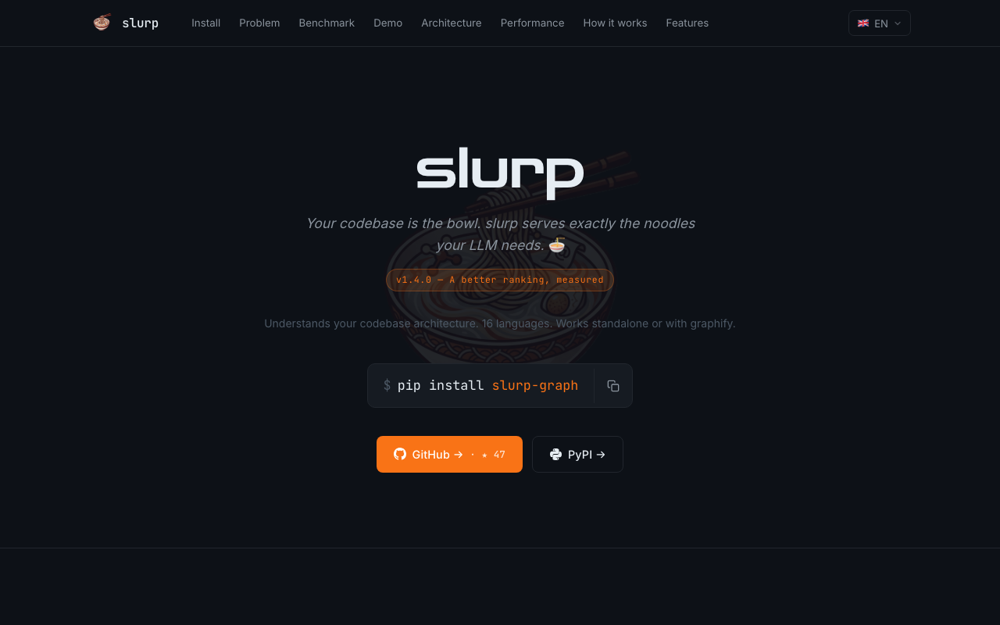
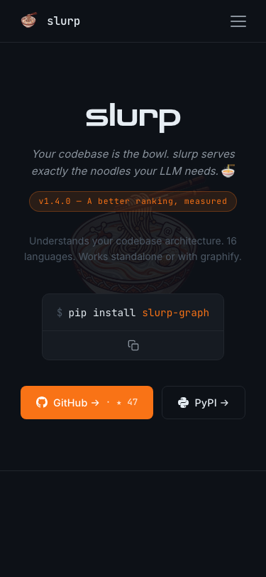

- **No enseña nada concreto.** Es una pila centrada de logo, lema, píldora, subtítulo, comando y
  dos botones. La cifra que justifica la herramienta (117,828 → 4,000 tokens) está una pantalla y
  media más abajo, y la salida real de slurp no aparece hasta la demo.
- **El logo hace de marca de agua y estorba.** Está detrás del texto, atenuado, y el subtítulo
  gris (`#4d5966`) queda encima de sus líneas: es el texto menos legible de la página en el sitio
  más visible.
- **Cuatro mensajes compiten** (lema, versión, subtítulo, comando) con el mismo peso y el mismo
  eje central. No hay un orden de lectura.
- **Es la composición que se reconoce como plantilla:** fondo `#0d1117` de GitHub, todo centrado,
  píldora de versión, botón naranja y botón fantasma.
- En escritorio sobra casi media pantalla vacía bajo los botones; en móvil el comando y su botón
  de copiar ocupan dos filas.

### 1.2 Jerarquía y ritmo

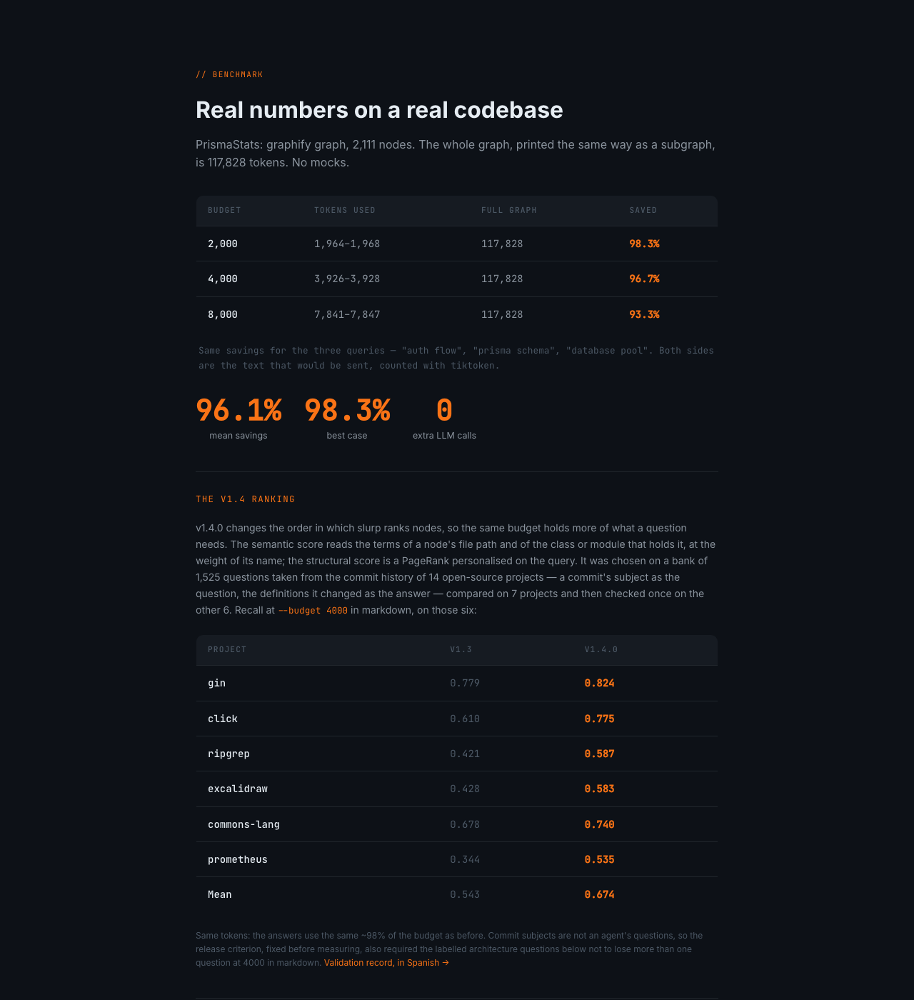

- **Todas las secciones tienen la misma forma:** etiqueta `// nombre` en naranja, titular,
  párrafo y bloque, en una columna de 780 px y con el mismo relleno vertical. La medición con
  agentes, que es lo más nuevo y lo más convincente, pesa lo mismo que la tabla de instalación.
- **Lo importante está enterrado.** «Measured with agents» es un sub-bloque al final de la
  sección más larga, a 12.900 px del inicio en móvil. El orden de la v1.4 va detrás de la tabla
  de ahorro, dentro de «Benchmark».
- **El naranja lo marca todo y por eso no marca nada.** Se usa en etiquetas de sección, títulos
  de tarjeta, cifras grandes, cifras de tabla, código en línea, enlaces, iconos y botones. No se
  puede distinguir «esto es un dato» de «esto es un enlace» de «esto es un adorno».
- **Repetición:** `slurp explain`, `slurp eval` y el grafo de llamadas aparecen en «Architecture»
  y otra vez en «Features», con textos distintos.

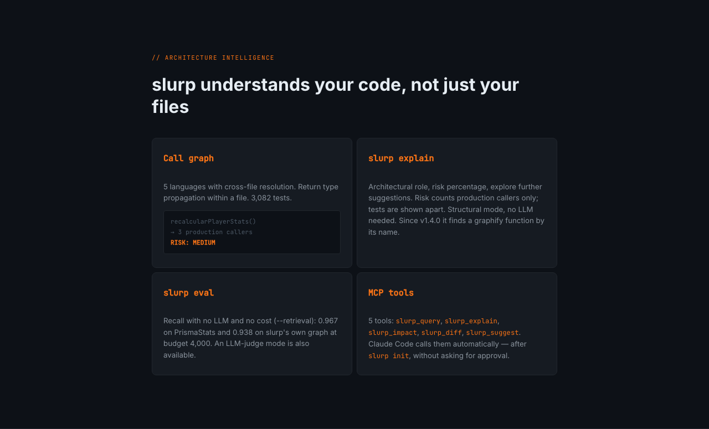
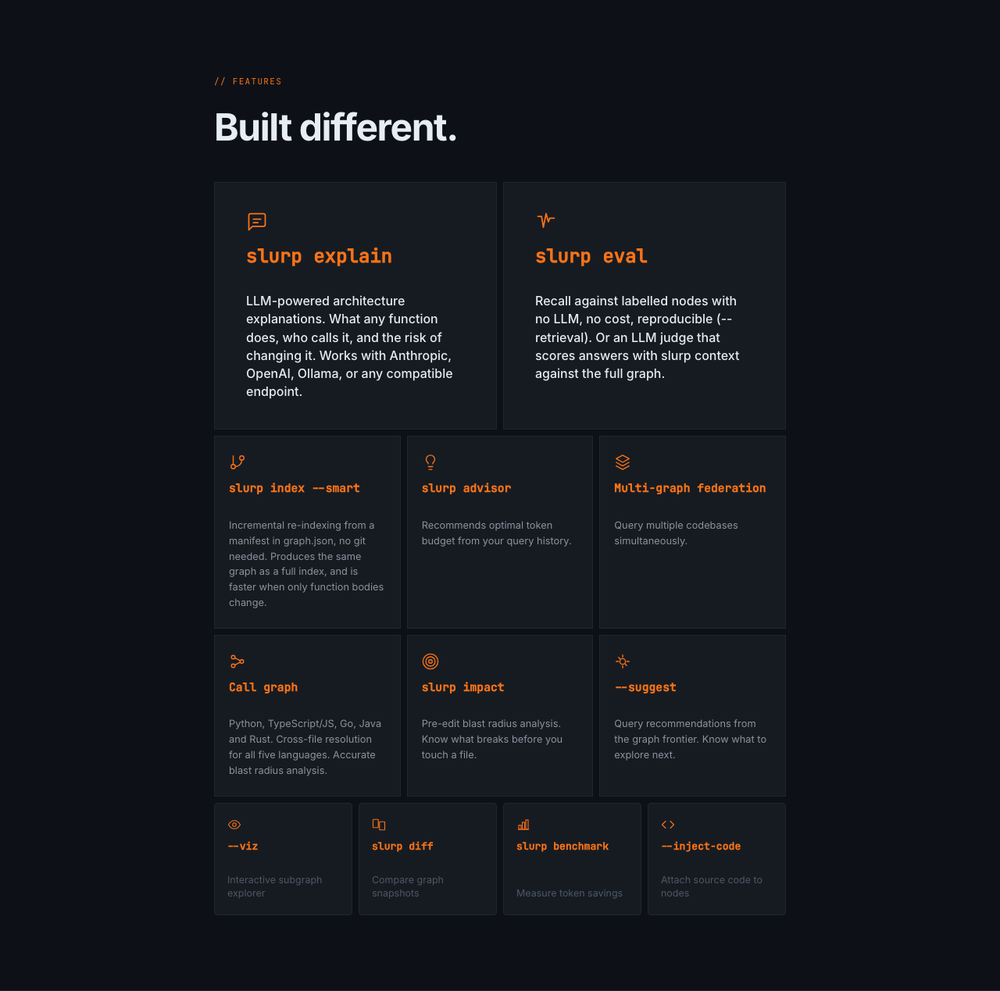

- Las rejillas de tarjetas (cuatro en «Architecture», doce en «Features») son cajas con borde,
  título naranja en monoespaciada y texto gris. Todas tienen la misma forma, y la altura
  sobrante de las cortas queda vacía.

### 1.3 Tipografía y densidad de texto

- **Demasiados tamaños muy parecidos.** 0,72 / 0,75 / 0,775 / 0,78 / 0,8 / 0,82 / 0,83 / 0,835 /
  0,85 / 0,875 rem conviven sin que la diferencia signifique nada. El ojo no encuentra niveles.
- **Líneas largas de texto pequeño.** Los párrafos explicativos van a 0,875 rem en una columna
  de 730 px: unas 110–120 letras por línea, cuando lo cómodo son 60–75. El bloque de latencia de
  la v1.4 son nueve líneas seguidas sin un solo apoyo visual.
- **El texto secundario no se lee.** El gris `#4d5966` sobre `#0d1117` tiene un contraste de
  **2,65:1** (2,42:1 dentro de las tarjetas). Se usa en las notas en monoespaciada, las cabeceras
  de tabla, el subtítulo del hero y los pies. WCAG AA pide 4,5:1.
- **La monoespaciada se usa para prosa** (notas de benchmark, de rendimiento y de graphify), que
  es donde peor se lee.
- Zen Dots solo aparece en una palabra: es una tercera familia que se descarga para cinco letras.

### 1.4 Cifras y tablas

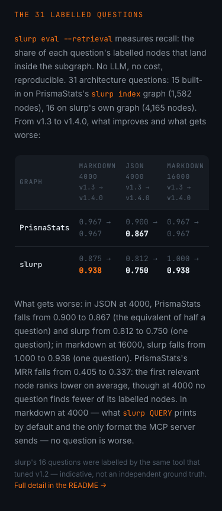
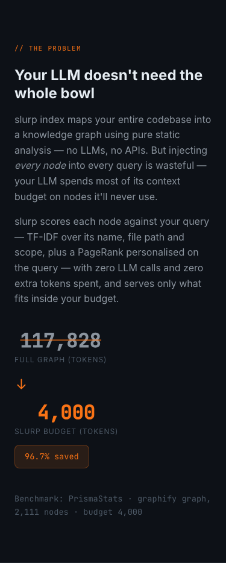

- **Las tablas son hojas de cálculo, no comparaciones.** En la del orden de la v1.4 hay que leer
  y restar catorce números para ver lo que una barra enseñaría de un vistazo.
- **Los números no están alineados para compararse:** van a la izquierda y sin cifras tabulares.
- **Mucho aire, poca información:** la tabla de seis proyectos ocupa unos 390 px de alto en
  escritorio para 21 celdas. La tabla de ahorro repite «117,828» en tres filas.
- **Las cabeceras** van en mayúsculas a 0,7 rem en el gris de 2,65:1: Lighthouse las marca como
  fallo de contraste.
- **Las cifras grandes** (96.1%, 98.3%, 0; 9/10, 0, 10/10; 3,082, 5) usan el mismo recurso tres
  veces: número naranja en monoespaciada y una línea debajo. La tercera vez ya no destaca.
- En «El problema», 117,828 y 4,000 se apilan como dos números del mismo tamaño: no se ve que
  uno es el 3,4 % del otro, que es justo lo que hay que ver.
- Lo que sí funciona y hay que conservar: las pérdidas de la tabla de preguntas etiquetadas se
  distinguen de las ganancias, y los límites de la medición van pegados a sus cifras.

### 1.5 Bloques de código

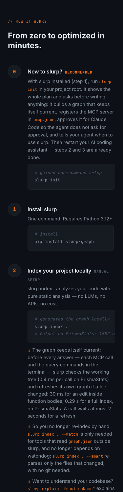

- **En móvil se cortan sin avisar.** La línea `# Output on PrismaStats: 1582 n…` y la de `"args"`
  del `.mcp.json` desaparecen por la derecha; hay desplazamiento horizontal, pero nada lo indica.
- **Solo el comando del hero tiene botón de copiar.** Los dos `.mcp.json`, que son lo que de
  verdad se copia, no.
- Los dos `.mcp.json` son casi idénticos y van uno detrás de otro.
- Los comentarios de los bloques (`# generates the graph locally`) están en inglés en los cinco
  idiomas.
- Los pasos mezclan cuatro notas `ℹ` seguidas con el mismo aspecto; ninguna destaca.

### 1.6 Navegación

- **Ocho enlaces con el mismo peso** que repiten los nombres de las secciones. No hay ninguna
  acción en la barra: ni GitHub ni el comando de instalación.
- En móvil todo se esconde tras la hamburguesa, incluido el cambio de idioma.
- **El selector de idioma no son enlaces:** son `<div>` con un `click`, no se pueden enfocar con
  el teclado, y usan banderas (🇬🇧 para el inglés) como etiqueta.
- No hay indicación de dónde estás al desplazarte por una página de 16.000 px.
- No hay favicon: la pestaña sale en blanco y `imjuank.dev/favicon.ico` devuelve 404.

### 1.7 Resumen

Lo que la hace parecer anticuada no es el color ni el fondo: es que **toda la página tiene un
solo nivel**. La misma columna, la misma caja, el mismo naranja y diez tamaños de letra casi
iguales para todo. El contenido es bueno y está medido; el diseño no ayuda a ver qué es lo
importante, ni convierte una sola de las comparaciones en algo que se vea.

---

## 2. Direcciones de diseño

Tres direcciones. Las tres mantienen el logo, el naranja `#f97316` y el fondo oscuro, y las tres
resuelven lo mismo: una escala tipográfica corta, el naranja reservado para una sola cosa, y las
comparaciones dibujadas en vez de tabuladas.

Cada boceto enseña el hero, el bloque de la medición con agentes y la tabla del orden de la
v1.4, a 375 px y a 1280 px, con el texto real en inglés. Son HTML renderizado, no dibujos: los
fuentes están en `docs/rediseno/bocetos/{a,b,c}.html`.

**Sobre el contenido en los bocetos:**

- Todas las cifras son las de la web actual. Las barras, puntos y cuadrados **dibujan cifras que
  ya están**: 9 de 10 son nueve marcas llenas y una vacía; la barra de 4,000 mide el 3,4 % de la
  de 117,828.
- En A y C la introducción de la tabla está abreviada para que el boceto quepa. En la
  implementación va el texto completo.
- B añade rótulos que hoy no existen («Fig. 1», «Table 2», «§ 07», «Read with care»). No son
  cifras, pero son texto nuevo que habría que traducir a los cinco idiomas: ver
  [decisiones](#5-decisiones-que-necesito).

### A — «La página es la salida»

**Idea:** la web se lee como la terminal de slurp; lo que la herramienta imprime es el diseño.

| | |
|---|---|
| Tipografía | IBM Plex Mono para titulares, datos y navegación; IBM Plex Sans para los párrafos. Dos familias, cinco tamaños. |
| Color | Negro casi puro (`#0a0a0a`), texto hueso, líneas de 1 px. El naranja significa **«lo que slurp seleccionó»**: nodos elegidos, tokens usados, el valor de la v1.4. Nada más, salvo el botón de copiar. |
| Hero | A la izquierda, el lema como titular y el comando. A la derecha, el panel real de `slurp "player stats" --budget 4000` con su cabecera (103/2111 nodos, 3,926/4,000 tokens) y dos barras a escala: grafo completo y presupuesto. |
| Medición con agentes | Tres celdas con borde. Cada cifra lleva diez cuadrados: nueve llenos y uno hueco, diez punteados, diez llenos. Los límites son líneas de comentario `#` bajo una regla lateral. |
| Tabla de recall | Tabla de terminal con cifras a la derecha y, en una cuarta columna, una barra por proyecto: gris hasta el valor de la v1.3, naranja el tramo que añade la v1.4. |

Bocetos: [`a-1280.png`](rediseno/bocetos/a-1280.png) · [`a-375.png`](rediseno/bocetos/a-375.png)

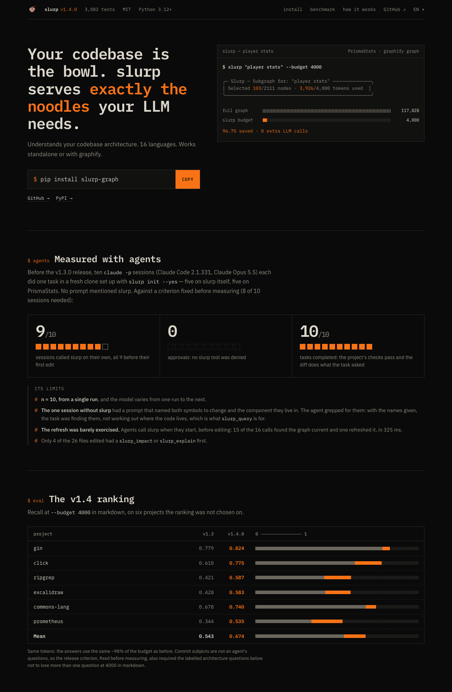

- **A favor:** es la más fiel a lo que slurp es; el hero enseña el producto; los bloques de
  código dejan de ser un cuerpo extraño.
- **En contra:** es la más cercana a lo que hay (oscura, monoespaciada, de desarrollador), así
  que el salto se nota menos. Los titulares en monoespaciada ocupan mucho en FR y DE.

### B — «El informe de medición»

**Idea:** slurp se presenta como un informe de laboratorio: cada cifra lleva su figura y sus
límites escritos al margen.

| | |
|---|---|
| Tipografía | Fraunces (serif de contraste alto) para titulares y cifras grandes; IBM Plex Sans para el texto; IBM Plex Mono solo para código y datos. |
| Color | Negro cálido (`#12100e`), texto color papel, filetes finos. El naranja es **tinta para los datos**: el punto de la v1.4, la cifra del presupuesto, las llamadas de nota. Los titulares no llevan naranja, salvo la cursiva del lema. |
| Hero | Rejilla de tres columnas: un margen izquierdo con la versión, el lema en serif a 62 px, y a la derecha la «Fig. 1»: 117,828 y 4,000 con sus dos barras a escala y el 96.7% saved. El logo va en la barra superior, nítido y a su tamaño, no como marca de agua. |
| Medición con agentes | Las tres cifras en serif grande bajo un filete, cada una con diez puntos. **Los cuatro límites van en el margen derecho, numerados, a la altura de las cifras**: se leen a la vez que el resultado. En móvil bajan a un bloque con regla lateral, justo después. |
| Tabla de recall | «Table 2»: una fila por proyecto con un gráfico de puntos sobre un eje de 0 a 1 (punto hueco la v1.3, punto naranja la v1.4, unidos por una línea) y las dos cifras alineadas a la derecha. Las advertencias, al margen. |

Bocetos: [`b-1280.png`](rediseno/bocetos/b-1280.png) · [`b-375.png`](rediseno/bocetos/b-375.png)

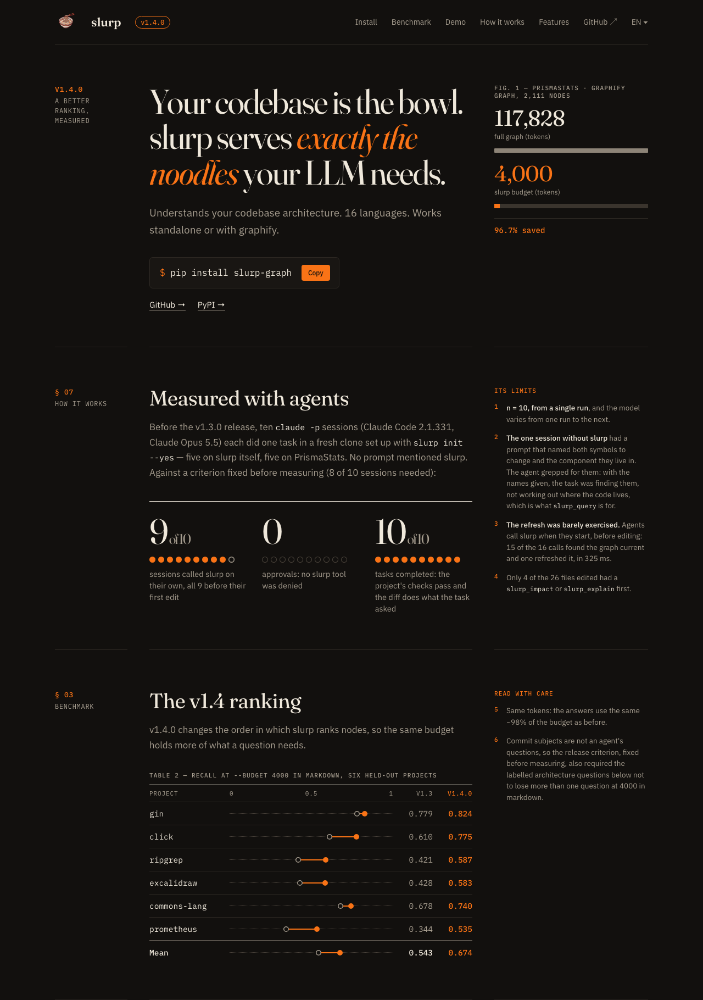

- **A favor:** convierte en identidad lo que distingue a slurp, que es medir y decir los
  límites. El margen de notas rompe los muros de texto sin quitar una palabra. Es la que mejor
  aguanta párrafos largos y cinco idiomas. No se parece a ninguna landing de herramienta de IA.
- **En contra:** una serif en una herramienta de terminal es una apuesta. En móvil el margen
  desaparece y el efecto se reduce. Añade rótulos nuevos que hay que traducir.

### C — «La barra de ramen»

**Idea:** la marca manda: el bol, el naranja a sangre y los datos servidos como tickets y carta
de un local de ramen.

| | |
|---|---|
| Tipografía | Bricolage Grotesque en pesos muy altos y ancho condensado para titulares y cifras; DM Mono para datos y tickets. |
| Color | Marrón casi negro (`#16110c`), crema y **bandas enteras en naranja** con texto oscuro (contraste 6,9:1). El naranja pasa de acento a superficie. |
| Hero | La palabra «slurp» a 300 px, el logo grande y sin atenuar, y un **ticket de caja** inclinado: grafo completo 117,828 tachado, presupuesto 4,000, llamadas extra a LLM 0, total «saved 96.7%», y el comando de instalación al pie. |
| Medición con agentes | Banda naranja a sangre con 9/10, 0 y 10/10 en negro a 96 px y una fila de diez boles. Los límites, en una tarjeta oscura inclinada al lado. |
| Tabla de recall | Carta de pizarra: nombre del proyecto, línea de puntos, valor de la v1.3 pequeño y tachado, valor de la v1.4 grande en naranja. La media, más grande. |

Bocetos: [`c-1280.png`](rediseno/bocetos/c-1280.png) · [`c-375.png`](rediseno/bocetos/c-375.png)

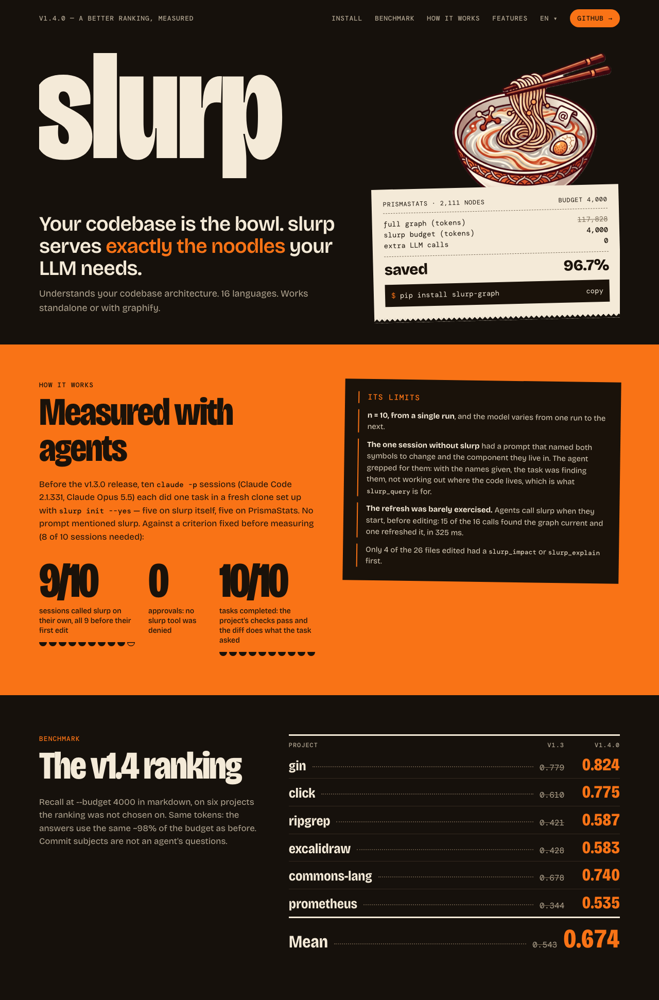

- **A favor:** es la más memorable y la que más usa el logo y la metáfora. El ticket explica el
  presupuesto de tokens mejor que cualquier párrafo.
- **En contra:** el tono festivo compite con la sobriedad de las cifras. Tachar el valor de la
  v1.3 lo presenta como un precio rebajado, y en la tabla de preguntas etiquetadas, donde hay
  pérdidas, ese recurso no sirve. Las bandas naranjas cansan en una página de 12.000 px, y los
  titulares condensados a 76 px rompen con palabras largas en alemán.

### Recomendación: B, con el hero de A

Recomiendo **B**. Motivos:

1. **Encaja con el contenido que hay.** La web tiene 2.500 palabras, cinco tablas y un límite
   declarado por cada cifra. B es la única dirección pensada para ese material: figuras
   numeradas, notas al margen y una columna de lectura de ancho correcto.
2. **Resuelve el problema del diagnóstico, que es la falta de niveles.** Serif para lo que se
   afirma, sans para lo que se explica, monoespaciada para lo que se teclea, naranja para el dato.
3. **Hace visible la honestidad de las mediciones**, que es lo que más diferencia a slurp. Los
   límites dejan de ser una lista al final y pasan a estar junto a la cifra.
4. **Es la que menos se parece a una plantilla** sin dejar de ser sobria.

De A tomaría una cosa: **el panel con la salida real de slurp en el hero**, como «Fig. 1», en
lugar de las dos cifras sueltas. Un desarrollador reconoce la herramienta al verla. De C tomaría,
como mucho, el ticket para el bloque «El problema»; el resto de C lo descarto por el tono.

Lo que B exige vigilar: FR y DE a 375 px (los titulares serif a 38 px admiten palabras largas
mejor que A y C, pero hay que comprobarlo), y el peso de Fraunces, que se serviría autoalojada y
recortada.

---

## 3. Visibilidad en buscadores y asistentes

### 3.1 Fuentes consultadas

Consultadas hoy, 2026-11-28:

| Fuente | Qué saqué |
|---|---|
| [Bing Webmaster Guidelines](https://www.bing.com/webmasters/help/webmaster-guidelines-30fba23a) | La guía principal. Cubre búsqueda, Copilot y «grounding». |
| [Bing — Sitemaps](https://www.bing.com/webmasters/help/sitemaps-3b5cf6ed) | Formatos y cómo enviarlos. |
| [Bing — How to create a robots.txt file](https://www.bing.com/webmasters/help/how-to-create-a-robots-txt-file-cb7c31ec) | Dónde va y cómo referenciar el sitemap. |
| [Bing — Marking up your site with structured data](https://www.bing.com/webmasters/help/marking-up-your-site-with-structured-data-3a93e731) | Formatos admitidos. |
| [Bing — Add and verify site](https://www.bing.com/webmasters/help/add-and-verify-site-12184f8b) | Alta y verificación. |
| [IndexNow — documentación](https://www.indexnow.org/documentation) y [FAQ](https://www.indexnow.org/faq) | Protocolo, clave y `keyLocation`. |
| [Bing — IndexNow, get started](https://www.bing.com/indexnow/getstarted) | Los cuatro pasos. |
| [llmstxt.org](https://llmstxt.org/) | La propuesta de `llms.txt`, v2. |
| [schema.org/SoftwareApplication](https://schema.org/SoftwareApplication) y [SoftwareSourceCode](https://schema.org/SoftwareSourceCode) | Propiedades disponibles. |

**Lo que no pude comprobar en fuente oficial:**

- **`hreflang` en Bing.** Las Webmaster Guidelines actuales no lo mencionan, y no encontré una
  página vigente de Bing que lo documente (la entrada antigua de su blog sobre idioma y país ya
  no existe). Lo propongo porque es la convención que usan los buscadores para relacionar
  versiones por idioma, pero no puedo afirmar con una fuente de Bing cuánto peso le da.
- **Google Search Console.** No consulté su documentación en esta fase; lo que digo de ella en
  3.9 es conocimiento general, no una lectura de hoy.

Lo que dice la guía de Bing y aplica aquí, citado por su número de apartado:

- **1.** Copilot y las experiencias de IA se apoyan en el mismo rastreo, indexado y ranking que
  la búsqueda normal. No hay un atajo aparte para asistentes.
- **2 y 4.** Para que descubra URLs: IndexNow, sitemaps XML, enlaces internos rastreables y
  enlaces externos. Avisar con IndexNow cuando una URL se añade, cambia o se borra.
- **3.** El sitemap lista solo URLs canónicas y lleva `lastmod` fiable.
- **5.** Enlaces con `<a href>` estándar y texto de ancla.
- **6 y 7.** No servir lo mismo en varias URLs; para un cambio permanente, redirección 301
  «en lugar de etiquetas canonical».
- **8.** No «esconder contenido crítico detrás del renderizado en cliente».
- **10.** `robots.txt` controla el rastreo, no el indexado. `NOARCHIVE` y `NOCACHE` limitan el
  uso en Copilot: no usarlos.
- **13.** `<title>` y meta descripción, jerarquía H1–H6 y HTML semántico. Títulos o descripciones
  ausentes, duplicados o demasiado cortos reducen la fiabilidad del indexado.
- **14.** Los datos estructurados «deben reflejar con exactitud el contenido visible» y no
  garantizan nada.
- **15–18.** Hechos explícitos, entidades nombradas de forma consistente, un tema por URL y la
  información esencial cerca del principio.
- **Abusos:** el contenido puesto para manipular modelos de lenguaje («prompt injection»)
  puede acabar en retirada del índice.

### 3.2 Estado actual

Comprobado con peticiones reales:

| Qué | Estado |
|---|---|
| `https://carlosvallejoruiz.github.io/slurp-web/` | 301 → `http://imjuank.dev/slurp-web/` → 301 → `https://imjuank.dev/slurp-web/` |
| `https://imjuank.dev/slurp-web` (sin barra) | 301 → con barra |
| `https://www.imjuank.dev/slurp-web/` | 301 → sin `www` |
| `https://imjuank.dev/robots.txt` | **404** |
| `https://imjuank.dev/sitemap.xml` y `/slurp-web/sitemap.xml` | **404** |
| `https://imjuank.dev/favicon.ico` | **404** (es el error de consola que ve Lighthouse) |
| `https://imjuank.dev/slurp-web/CLAUDE.md` | **200**: el fichero interno está publicado |
| `<link rel="canonical">`, Open Graph, Twitter Card, JSON-LD, `hreflang` | No hay ninguno |
| `<title>` y `<meta name="description">` | Uno, en inglés, para los cinco idiomas |
| Idiomas | Una sola URL. El idioma se cambia con JavaScript y se guarda en `localStorage` |
| Portada `https://imjuank.dev/` | Su `canonical` apunta a `https://carlosvallejoruiz.github.io`, que redirige |

### 3.3 Idiomas: hoy solo el inglés es indexable

**Hoy se cambia con JavaScript.** Los textos de ES, IT, FR y DE están en un objeto dentro de un
`<script>` y se inyectan al elegir idioma. Consecuencias:

- Un rastreador recibe siempre el HTML en inglés. Las otras cuatro versiones no tienen URL: no se
  pueden indexar, enlazar ni compartir.
- `<html lang="en">` es fijo en el HTML; solo cambia tras ejecutar el script.
- El HTML pesa 189 KB (47 KB comprimido) porque cada visitante descarga los cinco idiomas.
- Es el caso que la guía de Bing pide evitar en el apartado 8.

**Propuesta: una URL por idioma, generada como HTML estático.**

| Idioma | URL |
|---|---|
| Inglés (y `x-default`) | `https://imjuank.dev/slurp-web/` |
| Español | `https://imjuank.dev/slurp-web/es/` |
| Italiano | `https://imjuank.dev/slurp-web/it/` |
| Francés | `https://imjuank.dev/slurp-web/fr/` |
| Alemán | `https://imjuank.dev/slurp-web/de/` |

- El inglés se queda en la raíz: es la URL que ya enlazan PyPI y quien haya compartido la web.
  No se rompe ningún enlace.
- **Generación sin servidor:** una plantilla HTML y un fichero de textos por idioma (los mismos
  textos de hoy, sacados del `<script>`). Un script de Node sin dependencias escribe los cinco
  `index.html`. Sigue siendo HTML, CSS y JS sin frameworks.
- Cada página lleva su `<html lang>`, su `<title>`, su descripción, su `canonical` a sí misma y
  los cinco `hreflang` más `x-default`:

  ```html
  <link rel="canonical" href="https://imjuank.dev/slurp-web/es/" />
  <link rel="alternate" hreflang="en" href="https://imjuank.dev/slurp-web/" />
  <link rel="alternate" hreflang="es" href="https://imjuank.dev/slurp-web/es/" />
  <link rel="alternate" hreflang="it" href="https://imjuank.dev/slurp-web/it/" />
  <link rel="alternate" hreflang="fr" href="https://imjuank.dev/slurp-web/fr/" />
  <link rel="alternate" hreflang="de" href="https://imjuank.dev/slurp-web/de/" />
  <link rel="alternate" hreflang="x-default" href="https://imjuank.dev/slurp-web/" />
  ```

- **El selector de idioma pasa a ser cinco enlaces `<a href>`** con el nombre del idioma
  (English, Español, Italiano, Français, Deutsch). Son enlaces internos rastreables (apartado 5)
  y se pueden usar con teclado.
- **Sin redirección automática por idioma del navegador.** Quien entra en `/` ve inglés. Como
  mucho, un aviso discreto «¿Prefieres español?» que no bloquea nada.
- Una comprobación en la generación falla si a un idioma le falta una clave o si una cifra no
  coincide entre idiomas. Es la misma comprobación que usé al actualizar a la v1.4.0.

### 3.4 URL canónica, sitemap y robots.txt

**La URL buena es `https://imjuank.dev/slurp-web/`.** La de GitHub Pages ya redirige con 301 al
dominio propio, que es lo que Bing pide para una mudanza permanente (apartado 7). `pyproject.toml`
de slurp también declara `https://imjuank.dev/slurp-web` como Homepage. No hay nada que elegir:
solo hay que escribirla igual en todas partes, **con barra final**.

Tres sitios donde hoy no coincide:

- El `CLAUDE.md` de esta web da como URL final la de `github.io`.
- `pyproject.toml` de slurp la escribe sin barra final (un 301 de más; se arregla en la próxima
  versión de slurp, no corre prisa).
- La cadena de redirección de `github.io` pasa por `http://`. Suele deberse a que «Enforce
  HTTPS» no está activado en los ajustes de Pages del repositorio del dominio: compruébalo.

**`sitemap.xml`** en `https://imjuank.dev/slurp-web/sitemap.xml`, generado junto con las páginas:
las cinco URLs canónicas, cada una con `lastmod` (la fecha del último commit que cambió la
página, no la de cada despliegue) y sus alternativas `xhtml:link` por idioma.

**`robots.txt` tiene una pega: va en la raíz del host, y la raíz no es este repositorio.**

- Bing lo busca en `https://imjuank.dev/robots.txt`. Un `robots.txt` en `/slurp-web/` no vale.
- Esa raíz la sirve el repositorio de tu web personal (`CarlosVallejoRuiz.github.io`).
- Hoy devuelve 404, que equivale a «todo permitido»: no bloquea nada. Lo único que falta es la
  línea que anuncia el sitemap.
- Propuesta, **en el repositorio de la web personal**:

  ```
  User-agent: *
  Allow: /

  Sitemap: https://imjuank.dev/slurp-web/sitemap.xml
  ```

  Más el sitemap de la propia web personal, si lo tiene. Mientras no exista, el sitemap de slurp
  se envía a mano en Bing Webmaster Tools, que es suficiente.

**Lo que no debería publicarse.** GitHub Pages sirve hoy la rama entera: por eso
`/slurp-web/CLAUDE.md` es público, y `docs/` lo sería al fusionar esta rama. Propuesta: publicar
solo la carpeta generada (`dist/`) con un workflow de GitHub Actions, en vez de la rama. Ese
mismo workflow genera las páginas y avisa a IndexNow (3.7). Requiere que cambies una opción en
los ajustes de Pages (3.9).

### 3.5 Títulos, descripciones, Open Graph e imagen para compartir

Propuesta de título y descripción por idioma. Están hechos solo con afirmaciones y cifras que la
web ya muestra; **son texto nuevo y necesitan tu visto bueno**.

| | Título | Descripción |
|---|---|---|
| EN | slurp — token-budget graph navigation for AI coding agents | Open-source Python CLI and MCP server that serves your LLM only the relevant nodes of your codebase graph, within a token budget. 96.1% mean token savings, no LLM calls. |
| ES | slurp — navegación de grafos con presupuesto de tokens para agentes de código | CLI de Python y servidor MCP de código abierto que sirve a tu LLM solo los nodos relevantes del grafo de tu codebase, dentro de un presupuesto de tokens. 96,1% de ahorro medio, sin llamadas a LLM. |
| IT | slurp — navigazione di grafi con budget di token per agenti di codice | CLI Python e server MCP open source che serve al tuo LLM solo i nodi rilevanti del grafo del tuo codebase, entro un budget di token. 96,1% di risparmio medio, nessuna chiamata LLM. |
| FR | slurp — navigation de graphes à budget de tokens pour agents de code | CLI Python et serveur MCP open source qui ne sert à votre LLM que les nœuds pertinents du graphe de votre codebase, dans un budget de tokens. 96,1% d'économie moyenne, aucun appel LLM. |
| DE | slurp — Graph-Navigation mit Token-Budget für Coding-Agenten | Open-Source-Python-CLI und MCP-Server, der deinem LLM nur die relevanten Knoten deines Codebase-Graphen liefert, innerhalb eines Token-Budgets. 96,1% mittlere Ersparnis, keine LLM-Aufrufe. |

- La descripción actual termina en «Pure math.»; la propuesta lo cambia por qué es la
  herramienta (CLI de Python, servidor MCP, código abierto), que es lo que un buscador y un
  asistente necesitan para clasificarla.
- «Open source» se apoya en la licencia MIT, que la web ya enlaza.

**Open Graph y Twitter Card**, por página: `og:type=website`, `og:site_name=slurp`, `og:title`,
`og:description`, `og:url` (la canónica), `og:locale` y `og:locale:alternate`, `og:image` con
`og:image:width`, `og:image:height` y `og:image:alt`, y `twitter:card=summary_large_image`. Bing
documenta Open Graph entre los formatos que lee.

**Imagen para compartir:** un PNG de 1200 × 630 px, de menos de 300 KB, en `assets/og.png`,
compuesto con la dirección que elijas: el logo, el lema y «117,828 → 4,000 tokens · 96.7% saved».
Una sola imagen en inglés para los cinco idiomas, o una por idioma si lo prefieres. Se hace en la
fase 2, cuando haya dirección.

**Favicon:** no hay. Añadir `favicon.svg` o PNG de 32 px y `apple-touch-icon` de 180 px, sacados
del logo, y enlazarlos con `<link rel="icon">` (así no depende de la raíz del dominio).

### 3.6 Datos estructurados JSON-LD

Bing admite schema.org en JSON-LD y dice que no prefiere un formato sobre otro. Para una
herramienta de línea de comandos el tipo adecuado es **`SoftwareApplication`**; el lenguaje de
programación y el repositorio son propiedades de **`SoftwareSourceCode`**, así que propongo los
dos enlazados.

Cada valor sale del README de slurp v1.4.0 o de su `pyproject.toml`, y está visible en la web:

```json
{
  "@context": "https://schema.org",
  "@graph": [
    {
      "@type": "SoftwareApplication",
      "@id": "https://imjuank.dev/slurp-web/#software",
      "name": "slurp",
      "alternateName": "slurp-graph",
      "description": "Token-budget-aware graph navigation for AI coding agents. slurp scores every node of a codebase knowledge graph against a query and selects the subgraph that fits within a token budget.",
      "url": "https://imjuank.dev/slurp-web/",
      "applicationCategory": "DeveloperApplication",
      "softwareVersion": "1.4.0",
      "softwareRequirements": "Python 3.12+",
      "license": "https://opensource.org/licenses/MIT",
      "isAccessibleForFree": true,
      "downloadUrl": "https://pypi.org/project/slurp-graph/",
      "installUrl": "https://pypi.org/project/slurp-graph/",
      "softwareHelp": "https://github.com/CarlosVallejoRuiz/slurp/blob/main/USAGE.md",
      "sameAs": [
        "https://github.com/CarlosVallejoRuiz/slurp",
        "https://pypi.org/project/slurp-graph/"
      ],
      "author": {
        "@type": "Person",
        "name": "Juan Carlos Vallejo Ruiz",
        "url": "https://github.com/CarlosVallejoRuiz"
      },
      "inLanguage": "en"
    },
    {
      "@type": "SoftwareSourceCode",
      "name": "slurp",
      "codeRepository": "https://github.com/CarlosVallejoRuiz/slurp",
      "programmingLanguage": "Python",
      "runtimePlatform": "Python 3.12+",
      "license": "https://opensource.org/licenses/MIT",
      "targetProduct": { "@id": "https://imjuank.dev/slurp-web/#software" }
    }
  ]
}
```

Decisiones dentro del marcado:

- **Sin `aggregateRating`, sin `review` y sin `offers` con precio.** No hay valoraciones, y
  inventarlas es justo lo que Bing llama datos estructurados engañosos. Sin ellas no habrá
  estrellas en los resultados; es lo correcto.
- **Sin `operatingSystem`** de momento. El README da instrucciones para macOS, Linux y Windows,
  pero no declara una lista de sistemas compatibles. Si quieres que conste, dímelo.
- **Sin cifras de ahorro ni de recall** en el marcado: schema.org no tiene una propiedad para
  eso y meterlas en `description` sería forzarlo.
- `softwareVersion` se rellena en la generación desde un único sitio, el mismo que alimenta el
  badge y el pie, para que no se desincronicen.
- `inLanguage`, `url` y `description` cambian por idioma; el resto es igual en las cinco páginas.
- La instalación (`pip install slurp-graph`) no tiene propiedad propia: `installUrl` apunta a
  PyPI y el comando está en el HTML visible, cerca del principio.

### 3.7 IndexNow en GitHub Pages

IndexNow es un aviso por HTTP: «esta URL ha cambiado». Los buscadores que participan lo
comparten entre ellos. Solo hace falta un fichero de texto con una clave y una petición.

**La clave va en una subruta, no en la raíz.** La documentación ofrece dos opciones:

- Opción 1, clave en la raíz del host (`https://imjuank.dev/<clave>.txt`). Es la que
  «recomiendan encarecidamente», pero la raíz es el otro repositorio.
- Opción 2, clave en otra ruta, indicando `keyLocation` en cada aviso. Una clave en
  `https://imjuank.dev/slurp-web/<clave>.txt` **vale para las URLs que empiezan por
  `https://imjuank.dev/slurp-web/`**, que son todas las de esta web. Es la que propongo: no
  depende del otro repositorio.

**Cómo queda:**

1. Generar una clave (de 8 a 128 caracteres: letras, números y guiones) y guardarla en el
   repositorio como `<clave>.txt`, cuyo contenido es la propia clave. Es pública por diseño: el
   buscador la descarga para verificar.
2. Un workflow de GitHub Actions que, **después de que el despliegue de Pages termine**, envía:

   ```bash
   curl -sS -o /dev/null -w '%{http_code}\n' -X POST 'https://api.indexnow.org/indexnow' \
     -H 'Content-Type: application/json; charset=utf-8' \
     -d '{
       "host": "imjuank.dev",
       "key": "<clave>",
       "keyLocation": "https://imjuank.dev/slurp-web/<clave>.txt",
       "urlList": [
         "https://imjuank.dev/slurp-web/",
         "https://imjuank.dev/slurp-web/es/",
         "https://imjuank.dev/slurp-web/it/",
         "https://imjuank.dev/slurp-web/fr/",
         "https://imjuank.dev/slurp-web/de/"
       ]
     }'
   ```

3. Respuestas: `200` recibido; `202` recibido y clave pendiente de validar (normal la primera
   vez); `403` clave no encontrada; `422` URLs que no pertenecen al host o a la ruta de la clave;
   `429` demasiados envíos.

**Detalles que importan:**

- **El aviso va después del despliegue, no al hacer push.** Si Bing rastrea antes de que la
  página nueva esté servida, verá la vieja. Con el despliegue por Actions es un paso con
  `needs: deploy`.
- **Solo las URLs que cambiaron.** El workflow compara el HTML generado con el del despliegue
  anterior y avisa de las que difieren. Un cambio en el `CLAUDE.md` no avisa de nada.
- La FAQ de IndexNow dice que es para URLs añadidas, cambiadas o borradas, y que tras un
  rediseño es aceptable enviarlas todas. También dice que se use junto con el sitemap, no en su
  lugar.
- Un 200 solo significa «recibido». No garantiza rastreo ni indexado.
- La recepción se comprueba en Bing Webmaster Tools, en el apartado de IndexNow.

### 3.8 Contenido en el HTML, velocidad y accesibilidad

**Contenido en el HTML**

- En inglés, el texto ya está en el HTML. En los otros cuatro idiomas no: lo resuelve 3.3.
- **Sin JavaScript, casi toda la página es invisible.** Las secciones nacen con `opacity: 0` y un
  script las muestra al entrar en pantalla. El texto está en el HTML, pero un rastreador que
  evalúe lo visible, o un lector sin scripts, ve solo el hero. Propuesta: que el estado por
  defecto sea visible y la animación sea una mejora que solo se aplica si hay JavaScript y el
  usuario no ha pedido reducir el movimiento.
- Las estrellas de GitHub se piden a la API desde el navegador. Es decorativo y puede seguir así.
- Añadir `<main>`, y `<header>` y `<nav>` donde tocan. Un solo `<h1>` (ya es así) y una
  jerarquía de titulares sin saltos.
- La información esencial, arriba (apartado 18 de Bing): qué es slurp, cómo se instala y la
  cifra principal deben estar en el primer tramo del HTML. Las tres direcciones lo hacen.

**Velocidad**

| Problema | Medido | Propuesta |
|---|---|---|
| El logo es un PNG de 2048 × 2048 px y **2,7 MB**, usado a 40 px en la barra y como fondo del hero | Es el 95 % del peso de la página (2.805 KiB) y el elemento del LCP: **16,3 s** | Versiones WebP o AVIF a los tamaños reales (unos 80 px y unos 560 px), con `width` y `height`. Estimo decenas de KB en total. El original se conserva en el repositorio. |
| Dos hojas de Google Fonts bloquean el pintado | 790 ms estimados por Lighthouse | Fuentes autoalojadas en WOFF2, recortadas a los caracteres de los cinco idiomas, con `font-display: swap` y `preload` de la del titular. |
| Tres familias tipográficas | 89 KB de fuentes | Dos o tres según la dirección, pero recortadas. |
| El HTML lleva los cinco idiomas | 189 KB (47 KB comprimido) | Una página por idioma: en torno a una tercera parte. |
| El visualizador de la demo pesa 508 KB | **Hoy ya no se carga al entrar**: el `iframe` tiene `loading="lazy"` y en la medición de Lighthouse no se descargó | Mantenerlo, y mejorarlo con una carátula: una imagen ligera del grafo con un botón «Abrir la demo interactiva» que carga el `iframe` al pulsar. Así no se descarga tampoco al pasar desplazándose. |
| Caché de GitHub Pages | `max-age=600` en todo | No se puede cambiar en GitHub Pages. Con los recursos ya pequeños deja de importar. |

**Accesibilidad**

- **Contraste:** el gris secundario (2,65:1) y el texto blanco sobre el botón naranja (2,80:1)
  fallan AA. Las tres direcciones usan texto oscuro sobre naranja (6,9:1) y un gris secundario
  por encima de 6:1.
- **Falta `<main>`:** es el otro fallo que marca Lighthouse.
- **Selector de idioma** con enlaces reales, enfocables y con el nombre del idioma en vez de una
  bandera.
- **Tablas** con `<caption>` y `scope` en las cabeceras. Los gráficos de puntos o barras llevan
  siempre el número al lado: el color nunca es el único portador del dato, y las pérdidas se
  distinguen también por texto.
- **`prefers-reduced-motion`:** hoy no se respeta.
- **Bloques de código:** enfocables con teclado cuando tienen desplazamiento horizontal, y con
  botón de copiar etiquetado.
- Un enlace «Saltar al contenido» y foco visible en todos los controles.

### 3.9 llms.txt

**Qué es:** una **convención propuesta**, no un estándar. La publica Jeremy Howard en
llmstxt.org (versión 2, revisada en agosto de 2026). No la ha adoptado ningún organismo de
estándares, y **las Webmaster Guidelines de Bing no la mencionan**: nada de lo que he leído hoy
dice que Bing o Copilot la lean. Lo que sí dice Bing es que Copilot se apoya en el mismo índice
que la búsqueda; eso es lo que mueven los apartados 3.3 a 3.8.

Datos a favor de publicarla de todos modos:

- La propuesta dice que la usan sobre todo agentes de programación para encontrar documentación,
  que es exactamente el público de slurp.
- Lighthouse 13.6 trae una auditoría `llms-txt` dentro de una categoría nueva, «agentic
  browsing». En la línea base sale como «no aplicable» porque el fichero no existe.
- La v2 admite el fichero en una subruta: `https://imjuank.dev/slurp-web/llms.txt` cubre las
  páginas bajo `/slurp-web/`. No depende del otro repositorio.
- Cuesta veinte líneas y se genera con el resto.

**Recomendación: sí, pequeño y sin expectativas.** Un título, un resumen de una frase (el del
README), y enlaces a lo que ya existe en Markdown: el README, `USAGE.md`, la página de PyPI y los
registros de medición. Con `<link rel="describedby" href="llms.txt">` en las páginas, como
sugiere la propuesta.

Dos condiciones:

- **Solo afirmaciones del README.** Nada de frases dirigidas a que un asistente recomiende
  slurp: Bing lista eso como abuso («prompt injection and AI manipulation»), y además no
  funcionaría.
- No sustituye a nada de lo anterior. Si hubiera que elegir, va lo último.

### 3.10 Lo que tienes que hacer tú

Hay cuatro cosas que no puedo hacer desde el repositorio de la web.

**A. Bing Webmaster Tools**

1. Entra en `https://www.bing.com/webmasters` e inicia sesión con tu cuenta.
2. Añade el sitio. Bing admite una propiedad de dominio entero o de una sola rama. Recomiendo el
   dominio entero, `https://imjuank.dev/`: cubre slurp y tu web personal con una verificación.
3. Verifica la propiedad. Bing ofrece cuatro métodos:
   - **Verificación automática por DNS** (Domain Connect), si tu proveedor de DNS la admite:
     inicias sesión en el proveedor y Bing añade el registro.
   - **Registro CNAME en el DNS**, a mano, con el código que te da Bing. **Es el que recomiendo**
     si el anterior no aparece: no toca ningún repositorio.
   - **Fichero `BingSiteAuth.xml`** en la raíz del sitio: iría en el repositorio de tu web
     personal.
   - **Etiqueta `<meta>`** en la página principal: también en el repositorio de tu web personal.
4. En «Sitemaps», envía `https://imjuank.dev/slurp-web/sitemap.xml` (cuando exista).
5. En «IndexNow», comprueba que llegan los avisos del workflow tras el primer despliegue.
6. Si el panel ofrece una herramienta de inspección de URL, pásale `https://imjuank.dev/slurp-web/`
   y una de las páginas de idioma para ver cómo las ve Bingbot. No la he comprobado en la
   documentación: la cito por si está.
7. Los datos tardan unas 48 horas en aparecer, según la documentación de Bing.

**B. Google Search Console — recomendado**

Lo recomiendo por dos motivos: te da los datos de Google, y **Bing permite importar los sitios
verificados en Search Console**, con sus sitemaps, sin verificar otra vez (está en su página de
alta). El orden cómodo sería:

1. En `https://search.google.com/search-console`, añade una propiedad de tipo «Dominio» para
   `imjuank.dev` y verifícala con el registro TXT que te indique, en tu proveedor de DNS.
2. Envía allí el sitemap.
3. En Bing Webmaster Tools, elige «Importar desde Google Search Console» en el paso A.2.

Estos tres pasos son de conocimiento general, no de una lectura de la documentación de Google
hecha hoy: si la interfaz no coincide, manda la interfaz.

**C. Ajustes de GitHub Pages**

1. En el repositorio `slurp-web`: *Settings → Pages → Build and deployment → Source*, cambiar de
   «Deploy from a branch» a «GitHub Actions». Hazlo cuando el workflow esté fusionado, no antes:
   en ese orden la web no deja de servirse.
2. En el repositorio de tu web personal: *Settings → Pages*, comprobar que «Enforce HTTPS» está
   marcado (por el salto por `http://` de 3.4).

**D. En tus otros repositorios**

1. **Web personal** (`CarlosVallejoRuiz.github.io`):
   - añadir el `robots.txt` de 3.4;
   - corregir el `canonical` de la portada, que apunta a `github.io` y debería apuntar a
     `https://imjuank.dev/`;
   - añadir un `favicon.ico`;
   - enlazar la web de slurp desde la portada, si no lo hace ya.
2. **Repositorio de slurp:**
   - en GitHub, rellenar el campo «Website» del repositorio con `https://imjuank.dev/slurp-web/`
     (hoy está vacío);
   - enlazar la web desde el README (hoy no la enlaza);
   - en la próxima versión, poner la barra final en la Homepage de `pyproject.toml`.

   Son los «enlaces externos desde sitios relevantes» del apartado 2 de Bing, y son tuyos.

### 3.11 Orden propuesto para la fase 2

1. Generación estática por idioma, con `canonical`, `hreflang`, títulos, descripciones y
   `<main>`. Sin cambios visuales todavía: se puede publicar y medir por separado.
2. Logo y fuentes optimizados, favicon, contenido visible sin JavaScript.
3. Despliegue por Actions, `sitemap.xml`, clave y aviso de IndexNow, `llms.txt`.
4. JSON-LD, Open Graph e imagen para compartir.
5. Rediseño visual con la dirección elegida, sección por sección, con capturas en los cinco
   idiomas.
6. Lighthouse de nuevo, contra la línea base.

Separar 1–4 de 5 tiene una ventaja: lo que afecta a Bing puede estar publicado antes de que el
rediseño esté terminado.

---

## 4. Línea base (Lighthouse)

Lighthouse 13.6.0, emulación móvil con la limitación simulada por defecto, sobre
`https://imjuank.dev/slurp-web/` (commit `32ed687`), el 2026-11-28. Tres ejecuciones seguidas.

| Categoría | Ejecución 1 | Ejecución 2 | Ejecución 3 |
|---|---|---|---|
| **Rendimiento** | 73 | 73 | 73 |
| **Accesibilidad** | 94 | 94 | 94 |
| **Buenas prácticas** | 96 | 96 | 96 |
| **SEO** | 100 | 100 | 100 |

| Métrica | Ejecución 1 | Ejecución 2 | Ejecución 3 |
|---|---|---|---|
| First Contentful Paint | 2,1 s | 2,2 s | 2,1 s |
| Largest Contentful Paint | 16,3 s | 16,3 s | 16,1 s |
| Total Blocking Time | 0 ms | 0 ms | 0 ms |
| Cumulative Layout Shift | 0 | 0,006 | 0,006 |
| Speed Index | 2,1 s | 2,2 s | 2,1 s |
| Peso total | 2.804 KiB | 2.805 KiB | 2.805 KiB |

Qué hay detrás de cada nota:

- **Rendimiento, 73.** Casi todo es el LCP de 16,3 s, y el LCP es el logo de 2,7 MB. Lo demás va
  bien: sin bloqueo del hilo principal y sin saltos de diseño.
- **Accesibilidad, 94.** Dos fallos: contraste insuficiente (el botón de GitHub, el contador de
  estrellas y las cabeceras de tabla) y falta de `<main>`.
- **Buenas prácticas, 96.** Un fallo: el 404 de `https://imjuank.dev/favicon.ico` en la consola.
- **SEO, 100. No significa que el SEO esté resuelto.** Lighthouse comprueba lo básico: que hay
  título, descripción, que la página es rastreable y que los enlaces tienen texto. No mira si
  hay `canonical`, sitemap, datos estructurados, ni que cuatro de los cinco idiomas no tienen
  URL. Para esta categoría la comparación útil después no será la nota, sino la tabla de 3.2.
- Lighthouse 13.6 añade una categoría «agentic browsing» (100 en las tres): pasa el árbol de
  accesibilidad y el CLS, y da `llms.txt` y WebMCP como «no aplicable».

Ficheros: informe completo de la ejecución 2 en
[`rediseno/lighthouse/linea-base-movil.html`](rediseno/lighthouse/linea-base-movil.html) y las
cifras de las tres en
[`rediseno/lighthouse/linea-base-movil.json`](rediseno/lighthouse/linea-base-movil.json).

Para repetirla igual:

```bash
npx -y lighthouse https://imjuank.dev/slurp-web/ --chrome-flags="--headless=new" \
  --output=json --output=html --output-path=./run
```

---

## 5. Decisiones que necesito

1. **Dirección de diseño:** A, B o C. Recomiendo B con el hero de A.
2. **Rótulos nuevos de B** («Fig. 1», «Table 2», «§ 07», «Read with care»): ¿los acepto como
   texto nuevo traducido a los cinco idiomas, o B se hace solo con los textos que ya existen?
3. **Títulos y descripciones por idioma** de 3.5: ¿valen o los cambias?
4. **URLs por idioma** con el inglés en la raíz y `/es/`, `/it/`, `/fr/`, `/de/`: ¿de acuerdo?
5. **Despliegue por GitHub Actions** publicando solo `dist/`, que deja de exponer `CLAUDE.md` y
   `docs/`: ¿de acuerdo, o prefieres seguir publicando la rama y guardar el HTML generado en el
   repositorio?
6. **`operatingSystem`** en el JSON-LD: ¿lo dejo fuera, o quieres declarar macOS, Linux y
   Windows?
7. **`llms.txt`:** ¿lo incluyo?
8. **Secciones repetidas** («Architecture» y «Features» cuentan `explain`, `eval` y el grafo de
   llamadas dos veces): el rediseño puede mantener las dos tal cual o proponerte fusionarlas.
   Fusionar toca contenido, así que no lo haré sin que lo pidas.

---

## 6. Fase 2: lo que se ha hecho (2026-11-28)

Decisiones del autor: dirección **C**, con las cifras por delante de la decoración y sin tachar
el valor antiguo; títulos y descripciones aprobados; despliegue por GitHub Actions publicando
solo `dist/`.

### 6.1 Mejoras rápidas en `main` (commit `a0d1a56`, publicado)

Logo a su tamaño real en WebP con versiones 2x y 3x, favicon, contraste AA del gris secundario
y del botón naranja, y `<main>`. Sin cambios de texto ni de diseño.

Lighthouse 13.6.0, móvil, sobre `https://imjuank.dev/slurp-web/`, tres ejecuciones:

| | Antes (`32ed687`) | Después (`a0d1a56`) |
|---|---|---|
| Rendimiento | 73 / 73 / 73 | 97 / 98 / 90 |
| Accesibilidad | 94 | 100 |
| Buenas prácticas | 96 | 100 |
| SEO | 100 | 100 |
| LCP | 16,1–16,3 s | 2,0–3,4 s |
| FCP | 2,1–2,2 s | 2,0–2,2 s |
| Peso total | 2.805 KiB | 207 KiB |

La tercera ejecución dio 90 con un LCP de 3,4 s; las otras dos, 2,0 y 2,1 s. Lo que queda por
ganar son las dos hojas de Google Fonts que bloquean el pintado (unos 800 ms), que el rediseño
elimina.

### 6.2 El rediseño, en la rama `rediseno`

- **Dirección C** en toda la página. Bandas naranjas en «Zero dependencies», «Measured with
  agents» y el hito final; el ticket, solo en el hero.
- **Tablas y mediciones planas.** Números a la derecha con cifras tabulares. La medición con
  agentes lleva sus cuatro límites en una tarjeta al lado (debajo en móvil). El estudio de
  presupuesto dibuja los tres rangos sobre un eje de 0 a 100 %.
- **Antes y después, neutro.** En la tabla de las 31 preguntas cada celda es
  `0.900 → 0.867 ▼`: ganancias ▲ en naranja, pérdidas ▼ en un recuadro claro, sin cambio `=`,
  con leyenda. Nada tachado.
- **Una página estática por idioma**, generada por `node build.mjs` desde una plantilla y
  cinco ficheros de textos sacados del `index.html` anterior sin tocarlos.
- **Funciona sin JavaScript**: nada nace oculto, el idioma se cambia con enlaces y el
  visualizador es un enlace con carátula que, con JavaScript, se abre dentro de la página.
- **SEO:** `canonical`, `hreflang` y `x-default`, título y descripción por idioma, Open Graph
  y Twitter Card con `assets/og.png`, JSON-LD (`SoftwareApplication` + `SoftwareSourceCode`),
  `sitemap.xml`, `llms.txt`, clave de IndexNow y workflow de despliegue.
- **Fuentes autoalojadas**: sin peticiones a Google Fonts.

**Comprobaciones**

- Las cinco páginas a 375 px y a 1280 px: sin desbordamiento horizontal en ninguna.
- Cifras: ningún número visible de la web anterior falta en la nueva. El único número nuevo es
  el «100» del rótulo «100%» del eje de rangos.
- El build falla si a un idioma le falta una clave o si sus cifras no coinciden con las del
  inglés. Hoy pasa: 151 claves, mismas cifras en los cinco.
- Contraste: los trece pares de color del diseño están entre 6,6:1 y 15,7:1 (AA pide 4,5:1),
  incluido el texto sobre naranja (6,6:1). La auditoría de contraste de Lighthouse pasa en EN
  y en DE.

**Lighthouse del rediseño** (móvil, `dist/` servido en local, sin compresión):

| | EN (3 ejecuciones) | DE |
|---|---|---|
| Rendimiento | 100 / 100 / 100 | 100 |
| Accesibilidad | 100 | 100 |
| Buenas prácticas | 96 | 96 |
| SEO | 100 | 100 |
| LCP | 0,9 s | 0,9 s |
| Peso total | 240 KiB | 241 KiB |

Dos avisos sobre esta medición:

- **Es en local, no en la web publicada.** No hay latencia de red real, así que no es
  comparable al milisegundo con la tabla de 6.1. Hay que repetirla sobre la URL pública tras
  desplegar.
- **El 96 de buenas prácticas es un 403 de la API de GitHub** al pedir el número de estrellas:
  mi IP agotó hoy el límite de peticiones sin autenticar. La web publicada hace la misma
  petición y sacó 100 unas horas antes. Es del entorno de medida, no de la página.

Las auditorías de `canonical`, `hreflang` y `llms.txt` de Lighthouse pasan.

**Textos nuevos** (los once, en los cinco idiomas, en `src/i18n/`):

| Clave | EN | Para qué |
|---|---|---|
| `meta.title`, `meta.description` | los aprobados en 3.5 | `<title>`, descripción, Open Graph |
| `ui.skip` | Skip to content | enlace de teclado |
| `ui.sections`, `ui.lang` | Sections, Language | nombres de las dos navegaciones para lectores de pantalla |
| `ui.copy`, `ui.copied` | Copy, Copied | botones de copiar |
| `ui.demo.open` | Open the interactive demo | botón del visualizador |
| `ui.better`, `ui.worse`, `ui.same` | better, worse, unchanged | leyenda de ▲ ▼ = |

**Lo que cambia de sitio, sin cambiar de texto**

- El badge de versión pasa de píldora a línea sobre el lema.
- 117,828, 4,000, «extra LLM calls: 0» y «96.7% saved» aparecen también en el ticket del hero,
  además de en «El problema» y en el benchmark, donde ya estaban.
- La cabecera «v1.3 → v1.4.0» de la tabla de preguntas etiquetadas pasa a ser el título de la
  tabla en vez de repetirse en cada columna.
- «Architecture» y «Features» siguen siendo dos secciones con sus textos; pasan de tarjetas a
  listas.

**Lo que queda pendiente o conviene saber**

- **El `index.html` de la raíz ya no existe**: se borró cuando Pages empezó a publicar desde
  GitHub Actions.
- **Las carátulas del visualizador y `og.png` son capturas con cifras**: si la demo o los
  números cambian, hay que rehacerlas.
- **`lastmod` del sitemap** es la fecha del último commit que tocó `src/`, `assets/` o
  `build.mjs`.
- **La clave de IndexNow está en `src/site.json`** y se publica como fichero de texto: es
  pública por diseño.
- **No he probado el workflow en GitHub**: solo se puede ejecutar tras fusionar. Las versiones
  de las acciones son las últimas publicadas hoy (`checkout@v7`, `setup-node@v7`,
  `configure-pages@v6`, `upload-pages-artifact@v5`, `deploy-pages@v5`).
- **Los comentarios de los bloques de código siguen en inglés** en los cinco idiomas, como antes.

Capturas: una selección en `docs/rediseno/fase2/`; las diez páginas completas en
`.capturas/rediseno/` (sin versionar).

### 6.3 Publicado (commit `e563210`)

GitHub Pages publica `dist/` desde GitHub Actions. `CLAUDE.md`, `docs/`, `src/` y `build.mjs`
dan 404; las cinco páginas, `sitemap.xml`, `llms.txt` y la clave de IndexNow, 200.

Lighthouse 13.6.0, móvil, sobre la web publicada:

| | Línea base (`32ed687`) | Mejoras rápidas (`a0d1a56`) | Rediseño, EN (3 ejecuciones) | Rediseño, DE |
|---|---|---|---|---|
| Rendimiento | 73 | 97 / 98 / 90 | 100 / 100 / 100 | 100 |
| Accesibilidad | 94 | 100 | 100 | 100 |
| Buenas prácticas | 96 | 100 | 100 | 100 |
| SEO | 100 | 100 | 100 | 100 |
| LCP | 16,1–16,3 s | 2,0–3,4 s | 1,0–1,2 s | 1,1 s |
| FCP | 2,1–2,2 s | 2,0–2,2 s | 1,0–1,2 s | 1,1 s |
| CLS | 0–0,006 | 0,002–0,007 | 0–0,036 | 0,05 |
| Peso total | 2.805 KiB | 207 KiB | 201 KiB | 202 KiB |

El CLS sube algo (hasta 0,05; el umbral de «bueno» es 0,1): es el cambio de la fuente de
reserva a Bricolage Grotesque al cargar.
